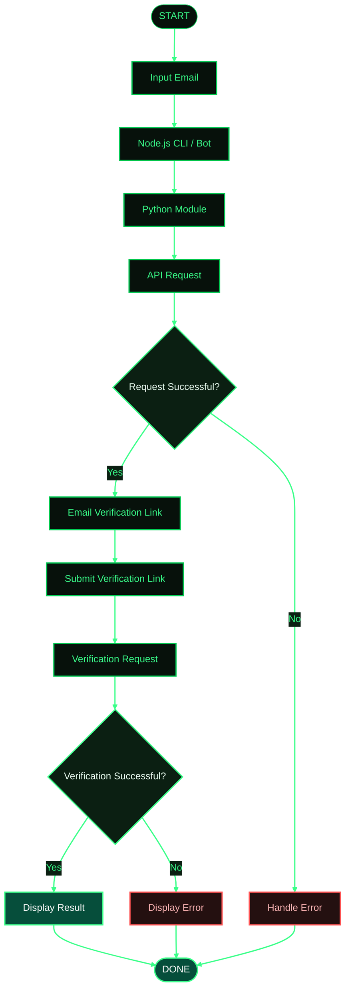

<div align="center">

<a href="https://github.com/kyuuXzry/ALIGHT-MOTION-PREM">

</a>

<br/>


<br/>

<a href="https://github.com/kyuuXzry/ALIGHT-MOTION-PREM">

</a>
<a href="https://github.com/kyuuXzry/ALIGHT-MOTION-PREM/stargazers">

</a>
<a href="https://github.com/kyuuXzry/ALIGHT-MOTION-PREM/network/members">

</a>
<a href="https://github.com/kyuuXzry/ALIGHT-MOTION-PREM/issues">

</a>

<br/>


<br/><br/>

**AUTOMATION · API INTEGRATION · DEVELOPER TOOLS**

<sub>Designed with precision. Built with purpose.</sub>

</div>

---

## `01 / OVERVIEW`

**ALIGHT-MOTION-PREM** merupakan project otomasi berbasis Node.js dan Python untuk mengelola workflow verifikasi email melalui antarmuka command-line dan integrasi bot, sesuai implementasi yang tersedia.

Project ini memisahkan pengelolaan alur aplikasi dan pemrosesan request agar lebih mudah dipelajari, dikelola, serta dikembangkan.

> **Disclaimer:** Project ini merupakan project independen dan tidak berafiliasi dengan Alight Motion. Gunakan hanya pada akun yang lu miliki atau yang telah memberikan izin. Hormati ketentuan layanan, batas akses, dan mekanisme keamanan platform.

## `02 / CORE FEATURES`

<table width="100%">
<tr>
<td width="50%" valign="top">

### ⚡ CLI Workflow

Menjalankan workflow melalui terminal menggunakan command yang disediakan project.

</td>
<td width="50%" valign="top">

### ⌘ Node.js Integration

Mengelola alur aplikasi menggunakan JavaScript dan Node.js.

</td>
</tr>
<tr>
<td width="50%" valign="top">

### ◈ Python Module

Memisahkan pemrosesan request ke modul Python.

</td>
<td width="50%" valign="top">

### ◎ Bot Integration

Integrasi melalui plugin bot apabila tersedia pada implementasi project.

</td>
</tr>
<tr>
<td width="50%" valign="top">

### ⇄ Request Processing

Mengelola request dan memproses respons dari layanan yang diizinkan.

</td>
<td width="50%" valign="top">

### ▣ Modular Structure

Struktur kode dapat dipisahkan berdasarkan fungsi dan tanggung jawab komponen.

</td>
</tr>
</table>

<div align="center">


</div>

---

## `03 / TECH STACK`

<div align="center">

### Languages & Runtime


### Libraries & Protocols


</div>

---

## `04 / REQUIREMENTS`

| Component | Requirement |
|:--|:--|
| Node.js | v18 atau lebih baru |
| Python | v3.10 atau lebih baru |
| npm | Package manager Node.js |
| Python dependencies | Mengikuti `requirements.txt` |
| Bot framework | Sesuai implementasi plugin, jika digunakan |

---

## `05 / INSTALLATION`

### Step 01 — Clone Repository

```bash
git clone https://github.com/kyuuXzry/ALIGHT-MOTION-PREM.git
cd ALIGHT-MOTION-PREM
```

### Step 02 — Install Node.js Dependencies

```bash
npm install
```

### Step 03 — Install Python Dependencies

```bash
python -m pip install -r requirements.txt
```

### Step 04 — Verify Installation

```bash
node --version
npm --version
python --version
```

Pastikan semua dependency berhasil terinstal sebelum menjalankan aplikasi.

---

## `06 / USAGE`

### CLI Mode

Jika entry point project berada di `src/tes-am.js`, jalankan:

```bash
node src/tes-am.js
```

### Bot Integration

Jika repository menyediakan plugin bot, integrasikan file plugin ke direktori yang sesuai dengan struktur aplikasi bot lu.

Contoh:

```text
plugins/
├── alightmotion.js
└── bypass.py
```

Pastikan lokasi file Python sesuai dengan path yang digunakan plugin JavaScript.

### Command Reference

| Command | Description |
|:--|:--|
| `.am-prem <email>` | Memulai workflow jika didukung plugin. |
| `.am-prem batal` | Membatalkan sesi jika fitur tersedia. |

> Nama command dan perilaku aktual harus disesuaikan dengan implementasi plugin di repository.

---

## `07 / WORKFLOW ARCHITECTURE`

<div align="center">


</div>

Diagram berikut menjelaskan alur input pengguna, pemrosesan Node.js, modul Python, dan respons API.

```mermaid
%%{init: {
  "theme": "base",
  "themeVariables": {
    "background": "#050B07",
    "primaryColor": "#0B1F12",
    "primaryTextColor": "#39FF88",
    "primaryBorderColor": "#00C853",
    "lineColor": "#39FF88",
    "secondaryColor": "#07110B",
    "tertiaryColor": "#0B1F12",
    "actorBkg": "#07110B",
    "actorBorder": "#39FF88",
    "actorTextColor": "#39FF88",
    "actorLineColor": "#00C853",
    "signalColor": "#39FF88",
    "signalTextColor": "#E8FFF0",
    "labelBoxBkgColor": "#0B1F12",
    "labelBoxBorderColor": "#00C853",
    "labelTextColor": "#39FF88",
    "noteBkgColor": "#0B1F12",
    "noteBorderColor": "#00C853",
    "noteTextColor": "#E8FFF0",
    "activationBkgColor": "#064E3B",
    "activationBorderColor": "#39FF88"
  },
  "sequence": {
    "showSequenceNumbers": true,
    "actorMargin": 65,
    "messageMargin": 38,
    "diagramMarginX": 25,
    "diagramMarginY": 25,
    "mirrorActors": false
  }
}}%%

sequenceDiagram
    autonumber

    actor U as USER
    participant N as NODE.JS
    participant P as PYTHON
    participant A as API TARGET

    rect rgb(5, 20, 11)
        Note over U,A: PHASE 01 - EMAIL VERIFICATION

        U->>+N: Input email
        N->>+P: Execute bypass.py send
        P->>+A: POST /api/send-link
        A-->>-P: Response status 200
        P-->>-N: SUCCESS
        N-->>U: Check inbox / spam
    end

    rect rgb(7, 28, 16)
        Note over U,A: PHASE 02 - LINK VERIFICATION

        U->>+N: Submit verification link
        N->>+P: Execute bypass.py verify
        P->>+A: POST /api/verify
        A-->>-P: JSON response
        P-->>-N: SUCCESS | UID | OrderId
        N-->>-U: Display verification result
    end
```



### Workflow Explanation

| Step | Process |
|:--:|:--|
| 01 | Pengguna memasukkan email. |
| 02 | Node.js meneruskan proses ke modul Python. |
| 03 | Modul Python mengirim request ke API yang digunakan. |
| 04 | Respons diproses dan status dikembalikan ke aplikasi. |
| 05 | Pengguna mengikuti instruksi verifikasi email. |
| 06 | Link verifikasi dikirim untuk diproses. |
| 07 | Aplikasi menampilkan hasil jika proses berhasil. |

**Catatan:** Endpoint dan format respons pada diagram mengikuti contoh yang diberikan. Pastikan sesuai dengan implementasi aktual.

---

## `08 / REQUEST FLOW`

Diagram berikut memperlihatkan gambaran alur keputusan, termasuk penanganan kondisi gagal.



---

## `09 / REPOSITORY STRUCTURE`

Contoh struktur direktori yang dapat digunakan:

```text
ALIGHT-MOTION-PREM/
├── assets/
│   └── alight-motion.svg
├── plugins/
│   ├── alightmotion.js
│   └── bypass.py
├── src/
│   └── tes-am.js
├── package.json
├── requirements.txt
└── README.md
```

> Struktur ini merupakan contoh dokumentasi. Sesuaikan dengan file yang benar-benar tersedia di repository.

---

## `10 / TROUBLESHOOTING`

<details>
<summary><b>01 — Node.js or Python Not Found</b></summary>

Pastikan runtime telah terinstal dan tersedia pada `PATH`.

```bash
node --version
python --version
```

Jika command tidak dikenali, periksa instalasi dan konfigurasi environment.

</details>

<details>
<summary><b>02 — Dependency Installation Failed</b></summary>

Periksa koneksi, versi runtime, dan nama package dalam file dependency.

```bash
npm install
python -m pip install -r requirements.txt
```

</details>

<details>
<summary><b>03 — Module or File Not Found</b></summary>

Pastikan command dijalankan dari root repository dan seluruh file berada pada lokasi yang sesuai.

Periksa kembali relative path yang digunakan kode.

</details>

<details>
<summary><b>04 — API Request Failed</b></summary>

Periksa koneksi, konfigurasi, respons server, serta izin akses.

Hormati autentikasi, rate limit, dan mekanisme keamanan layanan terkait.

</details>

<details>
<summary><b>05 — Verification Link Expired</b></summary>

Jika layanan menyatakan link telah kedaluwarsa, ikuti proses verifikasi resmi untuk memperoleh link baru.

Jangan membagikan link verifikasi atau token autentikasi kepada orang lain.

</details>

---

## `11 / SECURITY`

- Gunakan project hanya pada akun yang lu miliki atau yang penggunaannya telah diizinkan.
- Jangan menyimpan password, token, atau kredensial langsung di source code.
- Jangan membagikan link verifikasi maupun informasi autentikasi.
- Hormati ketentuan layanan dan pembatasan akses.
- Jangan menggunakan project untuk mengakses akun orang lain tanpa izin.

---

## `12 / CONNECT WITH KYUUAI`

<div align="center">


<br/>

**KYUUAI · PADUKA KYUU**

Developer focused on web scraping, REST APIs, automation, and full-stack development.

<br/>

<a href="https://github.com/kyuuXzry">

</a>
<a href="https://wa.me/628567126744">

</a>
<a href="https://instagram.com/rissxzry_">

</a>

<br/><br/>

<sub>BUILD · AUTOMATE · IMPROVE</sub>

<br/><br/>

<a href="#01--overview">

</a>


</div>