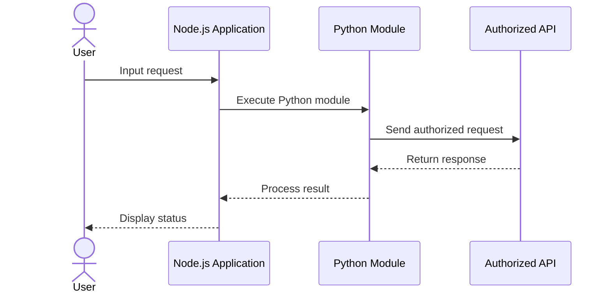

<div align="center">


# ALIGHT MOTION PREMIUM

### Automated Verification & API Client

Automated email verification workflow built with Node.js and Python.

<br/>

<a href="https://github.com/kyuuXzry/alightmotion-api-client">

</a>
<a href="https://github.com/kyuuXzry/alightmotion-api-client/stargazers">

</a>
<a href="https://github.com/kyuuXzry/alightmotion-api-client/network/members">

</a>


<br/>


</div>

---

## Overview

**Alight Motion Premium API Client** merupakan project otomasi berbasis Node.js dan Python untuk mengelola alur verifikasi email.

Project ini menyediakan antarmuka CLI serta integrasi plugin bot untuk menjalankan proses yang tersedia pada implementasinya.

> **Disclaimer:** Project ini merupakan project independen dan tidak berafiliasi dengan Alight Motion. Gunakan hanya pada akun yang Anda miliki atau yang telah mendapat izin. Hormati ketentuan layanan, batas akses, dan mekanisme keamanan platform.

## Features

<table width="100%">
<tr>
<td width="33%" align="center" valign="top">


### Request Handling

<sub>Pengelolaan request HTTP melalui Python.</sub>

</td>
<td width="33%" align="center" valign="top">


### Email Workflow

<sub>Alur pengiriman dan verifikasi email sesuai implementasi.</sub>

</td>
<td width="33%" align="center" valign="top">


### CLI Interface

<sub>Menjalankan workflow melalui terminal.</sub>

</td>
</tr>

<tr>
<td width="33%" align="center" valign="top">


### Node.js Integration

<sub>Integrasi dengan aplikasi berbasis JavaScript.</sub>

</td>
<td width="33%" align="center" valign="top">


### Bot Plugin

<sub>Opsi integrasi WhatsApp bot jika plugin tersedia.</sub>

</td>
<td width="33%" align="center" valign="top">


### Modular Structure

<sub>Pemisahan kode berdasarkan fungsi.</sub>

</td>
</tr>
</table>

## Tech Stack

<div align="center">


</div>

---

## Requirements

| Component | Requirement |
|:--|:--|
| Node.js | v18 or newer |
| Python | v3.10 or newer |
| npm | Included with Node.js |
| Python packages | Defined in `requirements.txt` |
| Baileys | Required only if the bot plugin uses it |

## Installation

### 1. Clone Repository

```bash
git clone https://github.com/kyuuXzry/alightmotion-api-client.git
cd alightmotion-api-client
```

### 2. Install Node.js Dependencies

```bash
npm install
```

### 3. Install Python Dependencies

```bash
python -m pip install -r requirements.txt
```

> **Note:** Gunakan environment Python terpisah jika diperlukan agar dependency project tidak mengganggu instalasi Python lainnya.

### 4. Configure the Project

Periksa konfigurasi yang diperlukan oleh project sebelum menjalankannya.

Pastikan:
- Node.js dan Python sudah terpasang.
- Seluruh dependency berhasil diinstal.
- File konfigurasi yang diperlukan tersedia.
- Penggunaan API mengikuti izin dan ketentuan layanan terkait.

---

## Usage

### CLI Mode

Jika entry point project memang berada di `src/tes-am.js`, jalankan:

```bash
node src/tes-am.js
```

### Bot Integration

Jika repository menyediakan plugin bot, integrasikan plugin mengikuti struktur aplikasi bot yang digunakan.

Contoh struktur plugin:

```text
plugins/
├── alightmotion.js
└── bypass.py
```

Pastikan lokasi file sesuai dengan path yang digunakan oleh kode plugin.

### Command Reference

| Command | Description |
|:--|:--|
| `.am-prem <email>` | Memulai alur verifikasi jika didukung plugin |
| `.am-prem batal` | Membatalkan sesi jika fitur tersedia |

> **Important:** Nama command, parameter, dan perilaku aktual bergantung pada implementasi plugin di repository.

---

## Workflow

Diagram berikut menggambarkan alur umum aplikasi. Endpoint dan respons aktual harus disesuaikan dengan implementasi yang tersedia.



## Repository Structure

```text
alightmotion-api-client/
├── assets/
│   └── alight-motion.svg
├── plugins/
│   ├── alightmotion.js
│   └── bypass.py
├── src/
│   └── tes-am.js
├── package.json
├── requirements.txt
└── README.md
```

*Struktur di atas merupakan contoh. Sesuaikan dengan file yang benar-benar tersedia di repository.*

---

## Troubleshooting

<details>
<summary><b>Node.js command not found</b></summary>

Pastikan Node.js telah diinstal dan dapat diakses melalui terminal.

Periksa instalasi:

```bash
node --version
npm --version
```

</details>

<details>
<summary><b>Python dependency error</b></summary>

Pastikan Python menggunakan versi yang sesuai dan dependency berhasil diinstal.

```bash
python --version
python -m pip install -r requirements.txt
```

</details>

<details>
<summary><b>Module or file not found</b></summary>

Periksa struktur direktori dan path yang digunakan oleh kode.

Pastikan command dijalankan dari root repository yang benar.

</details>

<details>
<summary><b>API request failed</b></summary>

Periksa koneksi, konfigurasi, respons server, dan izin akses.

Jangan mencoba melewati pembatasan keamanan atau mengakses akun maupun layanan tanpa izin.

</details>

---

## Author

<div align="center">


<br/><br/>

<a href="https://github.com/kyuuXzry">

</a>
<a href="https://wa.me/628567126744">

</a>
<a href="https://instagram.com/rissxzry_">

</a>

<br/><br/>

<sub>Built with precision. Maintained by KyuuAI.</sub>

<br/>


</div>