<div align="center">


# ALIGHT MOTION PREMIUM

**Email Verification Workflow & API Client**

A Node.js and Python project for email verification workflow management.

<br/>

<a href="https://github.com/kyuuXzry/ALIGHT-MOTION-PREM">

</a>
<a href="https://github.com/kyuuXzry/ALIGHT-MOTION-PREM/stargazers">

</a>
<a href="https://github.com/kyuuXzry/ALIGHT-MOTION-PREM/network/members">

</a>
<a href="https://github.com/kyuuXzry/ALIGHT-MOTION-PREM/issues">

</a>

<br/>


</div>

---

## Overview

**ALIGHT-MOTION-PREM** merupakan project otomasi berbasis Node.js dan Python yang dirancang untuk mengelola workflow verifikasi email melalui CLI dan integrasi bot sesuai implementasi yang tersedia.

Project ini menggabungkan pemrosesan aplikasi, request HTTP, dan penanganan respons dalam satu workflow.

> **Disclaimer:** Project ini independen dan tidak berafiliasi dengan Alight Motion. Gunakan hanya pada akun yang lu miliki atau yang telah memberikan izin. Hormati ketentuan layanan dan mekanisme keamanan platform.

## Features

| Feature | Description |
|:--|:--|
| CLI Workflow | Menjalankan aplikasi melalui terminal. |
| Node.js Integration | Mengelola alur aplikasi menggunakan JavaScript. |
| Python Module | Menangani pemrosesan request melalui Python. |
| Email Workflow | Mengelola proses verifikasi email sesuai implementasi. |
| Bot Integration | Mendukung plugin bot jika tersedia. |
| Error Handling | Membantu menangani respons dan kegagalan proses. |

## Tech Stack

<div align="center">


<br/><br/>


</div>

## Requirements

| Component | Version |
|:--|:--|
| Node.js | v18 or newer |
| Python | v3.10 or newer |
| npm | Included with Node.js |
| Python packages | Defined in `requirements.txt` |

## Installation

**1. Clone the repository**

```bash
git clone https://github.com/kyuuXzry/ALIGHT-MOTION-PREM.git
cd ALIGHT-MOTION-PREM
```

**2. Install Node.js dependencies**

```bash
npm install
```

**3. Install Python dependencies**

```bash
python -m pip install -r requirements.txt
```

**4. Check your environment**

```bash
node --version
npm --version
python --version
```

## Usage

### CLI Mode

Jika entry point project berada di `src/tes-am.js`, jalankan:

```bash
node src/tes-am.js
```

### Bot Integration

Jika plugin bot tersedia, sesuaikan penempatannya dengan struktur aplikasi bot yang digunakan.

Contoh:

```text
plugins/
├── alightmotion.js
└── bypass.py
```

### Command Reference

| Command | Description |
|:--|:--|
| `.am-prem <email>` | Memulai workflow jika didukung plugin. |
| `.am-prem batal` | Membatalkan sesi jika fitur tersedia. |

> Pastikan command dan lokasi file sesuai dengan implementasi sebenarnya.

---

## Workflow

```mermaid
%%{init: {
  "theme": "base",
  "themeVariables": {
    "background": "#0D1117",
    "primaryColor": "#111D16",
    "primaryTextColor": "#39FF88",
    "primaryBorderColor": "#238636",
    "lineColor": "#39FF88",
    "secondaryColor": "#0D1117",
    "tertiaryColor": "#111D16",
    "actorBkg": "#111D16",
    "actorBorder": "#39FF88",
    "actorTextColor": "#39FF88",
    "actorLineColor": "#238636",
    "signalColor": "#39FF88",
    "signalTextColor": "#E6EDF3",
    "labelBoxBkgColor": "#111D16",
    "labelBoxBorderColor": "#238636",
    "labelTextColor": "#39FF88",
    "noteBkgColor": "#111D16",
    "noteBorderColor": "#238636",
    "noteTextColor": "#E6EDF3",
    "activationBkgColor": "#173D27",
    "activationBorderColor": "#39FF88"
  },
  "sequence": {
    "showSequenceNumbers": true,
    "actorMargin": 60,
    "messageMargin": 35,
    "mirrorActors": false
  }
}}%%

sequenceDiagram
    autonumber

    actor U as User
    participant N as Node.js
    participant P as Python
    participant A as API

    rect rgb(13, 25, 18)
        Note over U,A: PHASE 01 - EMAIL VERIFICATION

        U->>N: Input email
        N->>P: Execute send workflow
        P->>A: Send authorized request
        A-->>P: Return response
        P-->>N: Processing status
        N-->>U: Verification instructions
    end

    rect rgb(15, 30, 22)
        Note over U,A: PHASE 02 - LINK VERIFICATION

        U->>N: Submit verification link
        N->>P: Execute verify workflow
        P->>A: Submit verification request
        A-->>P: Return verification result
        P-->>N: Process response
        N-->>U: Display final status
    end
```

<div align="center">


</div>



### Workflow Summary

```text
USER INPUT
    |
    v
NODE.JS APPLICATION
    |
    v
PYTHON MODULE
    |
    v
AUTHORIZED API
    |
    v
RESPONSE PROCESSING
    |
    v
RESULT DISPLAY
```

## Repository Structure

Contoh struktur project:

```text
ALIGHT-MOTION-PREM/
├── assets/
│   └── alight-motion.svg
├── plugins/
│   ├── alightmotion.js
│   └── bypass.py
├── src/
│   └── tes-am.js
├── package.json
├── requirements.txt
└── README.md
```

Sesuaikan struktur tersebut dengan file yang benar-benar tersedia di repository.

## Troubleshooting

<details>
<summary><b>Dependency installation failed</b></summary>

Periksa versi Node.js dan Python, koneksi internet, serta dependency yang tercantum dalam file konfigurasi.

```bash
npm install
python -m pip install -r requirements.txt
```

</details>

<details>
<summary><b>Module or file not found</b></summary>

Pastikan command dijalankan dari root repository dan path file sesuai dengan struktur project.

</details>

<details>
<summary><b>API request failed</b></summary>

Periksa koneksi, konfigurasi, respons server, dan izin akses. Hormati autentikasi, rate limit, serta mekanisme keamanan layanan.

</details>

<details>
<summary><b>Verification link expired</b></summary>

Ikuti prosedur verifikasi resmi untuk mendapatkan link baru jika link sebelumnya sudah kedaluwarsa.

</details>

---

## Author

<div align="center">

<a href="https://github.com/kyuuXzry">

</a>
<a href="https://wa.me/628567126744">

</a>
<a href="https://instagram.com/rissxzry_">

</a>

<br/><br/>

**KYUUAI · PADUKA KYUU**

<sub>Build clean. Automate smart.</sub>

</div>